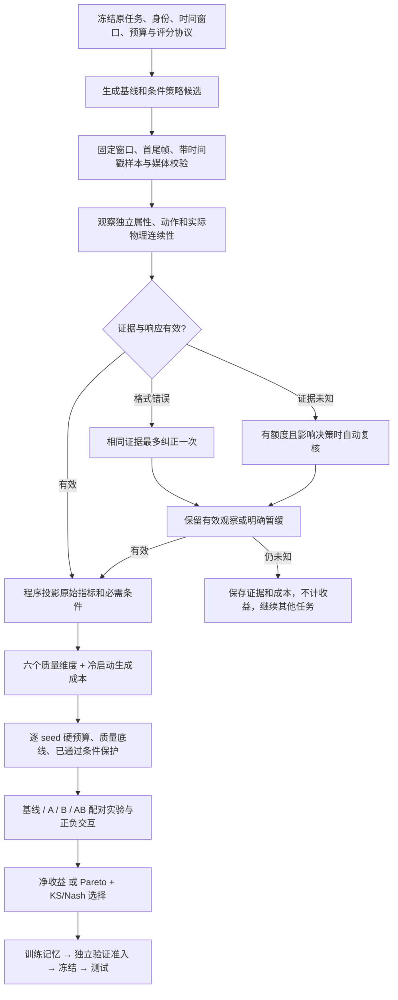

# V41：从视觉观察到预算内策略选择

当前维护版本：`isolated-observation-decision-v41.2`。属性观察：
`isolated-attribute-observations-v1.2`。决策维度：`story-quality-axes-v1`。
V41/V41.1 原始协议、提示词及匿名问题 ID 保留用于旧记录回放，不将旧响应重标为新观察。

## V41.2：状态中的角色编号消歧

V41.1 离线快照审计有 8 个可提交组件，其中 4 个完整、4 个仍未知。这不代表 8 段视频
评测完成，也未更新任何旧结果。原已 resolved 的 4 组并非新恢复的测量。
原暂缓的 market_change 第 1 镜可保留事件、起始位置和该镜 action alignment 的测量，
但其末状态和第 2 镜动作仍未知，不能因此认为全片 action alignment 已确定。

审计还暴露了起始 token.location 从 0 到 1 的可疑翻转。按已知请求目录重建得到同一
问题 ID `o_4f7829ec893d7eb9`，其问题是 `token.location equals 'A hand'`；保存的响应却以
“在 actor B 手里”支持它。这是问题与回答的语义矛盾，不是视觉真值验证。现有 JSON、
引用和外观绑定校验无法发现所有此类错误，`snapshot_committable` 也不保证判断正确。

新编译器将**结构化状态**里已在原始身份注册表声明的角色编号显式写为 `ACTOR[A]`、
`ACTOR[B]`，并附上各自的 appearance_id。`A hand` 因而成为 `ACTOR[A] hand`，明确表示
A 的手而非任意一只手。角色自身属性如 `A.location` 同样消歧，所有候选值一视同仁，
不泄露目标选项。未声明的形状字母（如 V shape）、普通小写冠词、setup/事件自然语言
保持不变；原始 benchmark、主机端命题、目标映射和旧分数也保持不变。

这项修改减少源语言歧义，**不构成通用语义验证器，也不能保证模型不再答非所问**。
不添加新的响应字段、投票轮数或基于文字自动反转分数的规则。未进行真实模型复测前，
不能宣称视觉准确率或覆盖率提高。共享持有、遮挡和身份模糊仍由模型观察，允许未知。

同步 `src/evovideo_skill/`、`scripts/`，回归测试及说明在 `tests/`、`docs/`。
配置、benchmark、准备素材及 H3 权重没有变化。先运行零 API 检查：

```bash
PYTHONPATH=src:tests python -m unittest test_evaluation_v412 test_evaluation_v411 test_evaluation_v41 test_verifier_identity
PYTHONPATH=src python scripts/check_evaluation_contract.py \
  --config configs/h3_story350_debug.json \
  --task-file benchmarks/story350/story350.json \
  > outputs/evaluation_v412_contract.json
```

预检的 `actor_bound_state_hypotheses` 记录实际消歧的问题数量（包含非目标候选，不是
视频数）。若进行付费验证，沿用本文预先固定的三任务、seed=42，只运行一次并使用
新的 `outputs/h3_v412_canary_XXXXXX` 目录。旧快照不重新标为 V41.2 结果。

V41.2 本地全量 1081 项测试通过；debug 配置对全部 350 条 Story350 任务静态编译通过。
其中 162 条任务含角色状态表达，final 请求共 2302 个带角色绑定的状态候选问题。
未调用真实评估模型或 H3；这些检查不衡量视觉准确率。

## V41 固定三任务复测后的修正

这批运行没有最终格式错误，但三个独立判断中两个暂缓。测试通过并不代表视觉测量
足以支撑学习；也不能把自动暂缓正常工作当成评估已稳定。

已确认两处协议/实现问题及一类模型分类问题，统一修正如下：

1. **复核有效但不完整，不能整组丢失。** 配置固定为
   `auto_review.commit_policy=validated_snapshot`，仅用于一次增强复核。
   格式、引用、身份和共享事实一致性均通过后，整体采用该次复核快照，连同未知和
   相比初评降低的分数一起采用；禁止跨轮挑选各指标的有利结果。完整性与快照提交分开，
   仍未知的视频不会因此获得学习收益或策略准入。冲突、无效响应和不足确认仍保留初评。
   旧的 `resolved_only` 及双确认机制保留，双确认不能配置此单次快照策略。
2. **动态状态需要短序列。** 对状态命题中明确的 moving/rotating/spinning/rolling/
   flowing/swinging/oscillating/vibrating 词，使用同镜边界向内 0.5 秒邻域估计局部运动。
   已知判断必须引用完整边界及至少一个不同时间的邻近样本；同时间裁剪不算第二帧，
   中后段动作不能代替前边界运动。静态形状、位置仍用精确边界。此规则是保守词法路由，
   不覆盖所有自然语言时态，也不由程序判断物体是否运动。实际观察定义记录在
   `temporal_measurement` 和 `measurement_overrides` 中；它不是瞬时速度的精确测量。
3. **可见未完成与看不清分开。** 恢复完整动作在指定窗口内的完成语义，说明已识别物体
   的明确错误位置可构成反例；对象混淆、遮挡和实质采样缺口仍未知。最终状态单独不能
   排除更早完成过动作。程序不根据模型文字或另一选项的分数自动把未知改为失败。

不增加调用轮数，不改变生成预算或净收益/KS/Nash 目标。三任务记录并不能证明视觉
准确率已提高，修正后的真实覆盖率也尚未测得。

同步代码后，首先复用**已有决定文件**作零模型调用审计，不重跑三任务：

```bash
PYTHONPATH=src python scripts/audit_review_snapshots.py \
  --run-dir outputs/h3_v41_canary_DCgHHX \
  > outputs/h3_v41_canary_DCgHHX.snapshot-audit.json
```

此审计报告哪些初评未知项已有合法的复核测量、哪些原已知项会变成未知、哪些数值会
改变。它只比较提交策略，不更新原结果、不补判视觉证据、不重新验证原请求的全部
引用/身份，也不能据其组件计数宣称整段评估已完成。历史数据不能回放出新提示词的回答。
自动诊断新增 `review_snapshot_commits`，明确记录完整快照采用与评估暂缓的区别。

V41.1 本地全量 1076 项测试通过，最后诊断/预检衔接后的 48 项相关测试通过。
debug、KS、Nash、net 四配置各静态编译 350 条任务；每种配置的 final 请求共识别出
156 个边界运动候选问题（包括非目标候选，不是 156 个独立任务）。未调用真实模型。

这次同时修改观察、汇总、预算可行性和策略选择，保留净收益对照。
不是将旧视频改判为通过，也不是保证多模态模型不再犯错。



## 1. 限制模型跨指标推断

原来模型同时读到完整剧情、目标状态和多个指标，容易用“在手里”否定“直泥条”，
或将起点错误当成后续动作不存在。现在 Story350 的源事实请求采用独立观察接口：

- 对状态属性，程序从同一任务的声明中收集该属性的候选值，以匿名问题 ID 提交。
  每个当前边界都询问同一组值，不标记当前期望值。候选可重叠，不强迫单选。
- 模型仅返回 `basis/confidence/evidence/evidence_refs`。程序私下把目标问题映射回原指标。
  另一个候选成立，不能自动把目标判为不成立；目标未知也不能由其他候选补齐。
- 动作保留原句及明确的 while/without/before 等限定；初始 setup 只保留其原句。
  这些仍是命题判断，并非一个经过标定的通用视觉事实抽取器。
- 实际发送的源事实文本只包含观察问题、媒体目录和身份契约，不含完整任务、
  生成提示、阈值、权重、目标映射或收益。普通全局质量指标仍使用各自的原有评估路径。

`*.wire-request-N.json` 是这类请求实际发送的文本；`*.request-N.json` 保留主机侧
完整上下文供离线回放；`*.host-projection.json` 保留目标映射。原始响应不被改写。
更多候选可能增加输出 token；不增加调用轮数，不代表费用必然下降。

`state_flow` 在本协议中明确改为**实际物理连续性**：比较前一镜实际末帧、当前首帧和
当前运动轨迹。错误起点、目标未达成不单独构成跳变；实际消失、复制、无解释重置才是
连续性问题。预期状态和动作另行评估，仍是必需条件。
这是版本化的测量定义调整，写入 `measurement_overrides`、验收和报告；不修改原始任务文件。
新旧协议的连续性分数不能直接合并。

## 2. 固定质量维度，保留细项保护

KS/Nash 配置使用 `bargaining.metric_source=axes`：

| 决策维度 | 汇总方式 |
|---|---|
| 身份 | 身份、服装、跨镜身份指标取最小值 |
| 场景 | 背景保留、场景几何取最小值 |
| 运动与连续性 | 运动质量与各镜实际连续性均值取最小值 |
| 视觉质量 | 原视觉质量指标 |
| 动作 | 主机按原事件、义务和顺序汇总的 action alignment；不再给其子项额外投票 |
| 状态 | 每镜 pre/post/invariant 内求均值，阶段等权，再分镜等权 |

只使用原合同声明的成员。缺失成员保留未知，不能丢掉后重新求平均。
这些是明确的维度权重设计，不代表六个统计独立或已标定的潜在因子。
原始全部指标仍保留，必需条件、已通过约束和局部窗口退化保护继续生效。
`quality_axes` 同时写入执行记录、最终评分与 HTML/JSON 报告。

## 3. 成本和博弈规则

- 调用次数、生成视频秒数按从头执行整张图计价；缓存命中不降低部署成本。
  实际搜索预留预算、失败调用、评估调用、token 和客户端耗时分别记录。
- 硬成本上限与质量底线逐 seed 检查。一个 seed 超限不能靠其他 seed 平均掩盖。
- 质量和成本参考点在运行前固定，新增候选不改变老候选的归一化值。
  调用数与视频秒数合成一个保守成本参与方，避免相关成本重复投票。
- KS 主目标是最大化最差归一化达成度；当聚合主目标相同，且任何配对 seed 的主目标
  都未退化时，允许使用 log-Nash 改进作次级比较。单独阈值为 `min_tiebreak_gain`，默认 0.01。
  原有质量、逐指标、必需条件保护和配对支持检查仍须通过。
- 主目标增益和 log-Nash 增益分别报告。记忆检索使用有界 `tanh(log-Nash 增益)` 信号，
  不将它称作质量增益；混合层级的检索均值不是实验效应量。验证按各比较的层级阈值判断。
- Nash 模式和原净收益模式均保留。`h3_story350_net.json` 关闭 bargaining，仍按原质量
  收益减成本惩罚选择；它与 KS/Nash 使用相同新评估接口，便于公平对照。

这仍是有限离散候选上的约束协商启发式，不是已证明的全局最优或经典公理化博弈均衡。
log-Nash 在零达成度使用既有的固定 `1e-12` 数值下限，其增益对该约定有依赖。
当前成本代理也不等于 GPU 秒或金额；未测量部分保持空值。

## 4. 条件组合如何沉淀

同一任务和 seed 上评估共同基线、A、B、AB，记录每个原始指标和 `axis.*` 的
`Q(AB)-Q(A)-Q(B)+Q(base)`，以及调用数、视频秒数和净收益交互。
预算、可行性和正负影响与图结构一起保存。正交互不自动让 AB 获得准入；它仍需相对
当前策略有支持的改善并通过保护检查。未知实验保留排除记录，不当作零增益样本。
配对记录还检查评估协议、观察协议和 profile 相同，禁止混入不同模型或采样配置的分数。

训练用于发现经验，验证用于准入，测试阶段先提交视频再评分。调试集和旧视频复测用于
开发诊断，不能拿来宣称 held-out 增益。用户已看到且用于修改方法的任务不再是干净测试集。

## 5. 有界运行，减少逐例手工修正

继续使用一次初评、最多一次格式修正和预算内复核。合法低分不触发重投票；遮挡允许未知。
耗尽预算仍未知的结果自动暂缓、不学习、不准入，继续其他任务，不需要人工逐个解锁。
接口欠费、媒体损坏、配置不一致仍应停止，避免把系统故障当成视频低质量。

固定预检脚本 `check_evaluation_contract.py` 与生产使用相同契约编译函数，覆盖全部任务，
检查六维目标、源事实投影和调用上界。它不调用模型，也不把缺少媒体的静态编译当视觉验证。
不要重复新建目录付费重评，直到结果变好；一批固定任务一次运行后统一看覆盖率、格式失败、
质量、预算和排除比例。若有系统性问题，保存整批响应作回归，不再只贴单个失败任务改提示。

## 6. 同步与固定验证步骤

本次同步 `src/evovideo_skill/`、`configs/`、`scripts/`、`tests/`、`docs/` 和 `README.md`。
运行必需的是前三项；测试目录用于零 API 回归。原始 benchmark 和已准备素材未改。
以下命令在服务器仓库根目录执行，沿用已配置的模型、API key 和 H3 服务环境。

先离线检查整个 Story350（无需 key）：

```bash
set -o pipefail
mkdir -p outputs
PYTHONPATH=src python scripts/check_evaluation_contract.py \
  --config configs/h3_story350_debug.json \
  --task-file benchmarks/story350/story350.json \
  > outputs/evaluation_v41_contract.json
PYTHONPATH=src:tests python -m unittest test_evaluation_v41 test_conditioning_bargaining
```

随后只做一次预先固定的三任务、seed=42 复测。先 dry-run 查看本机可用视频，再执行。
这一步会调用付费 verifier，不调用 H3；旧结果不变，缺失基线仍明确缺失。

```bash
review_dir="$(mktemp -d outputs/h3_v412_canary_XXXXXX)"
recheck_args=(
  --run-dir outputs/h3_story350_semantics_v2_RowaH0
  --config configs/h3_story350_debug.json
  --task-file outputs/story350_smoke15_semantics_v2_prepared/story350_h3.json
  --task-id story350-clay_coil
  --task-id story350-chain_toy
  --task-id story350-market_change
  --seed 42
  --output-dir "$review_dir"
)
PYTHONPATH=src python scripts/recheck_conditioning_outputs.py "${recheck_args[@]}" --dry-run
PYTHONPATH=src python scripts/recheck_conditioning_outputs.py "${recheck_args[@]}" \
  2>&1 | tee "$review_dir.log"
PYTHONPATH=src python scripts/diagnose_verifier_batch.py --run-dir "$review_dir" \
  > "$review_dir.diagnostics.json"
PYTHONPATH=src python scripts/report_evaluation.py --run-dir "$review_dir"
```

报告中的 `complete` 表示评估完成，`failed` 可以是有效的负面质量证据；不要求视频全部通过。
明确未知允许自动暂缓。反复出现无效响应、身份错绑、越界证据或大量暂缓时，不扩大付费实验，
先统一诊断该批次。单次结果一致不证明模型重复稳定或视觉判断正确。

确认流程和覆盖率可用于实验后，新建生成运行目录；不要复用旧学习状态或旧分数：

```bash
run_dir="$(mktemp -d outputs/h3_story350_v41_debug_XXXXXX)"
run_args=(
  --config configs/h3_story350_debug.json
  --task-file outputs/story350_smoke15_semantics_v2_prepared/story350_h3.json
  --phase all --test-protocol both
  --candidate-review-policy skip-experiment
  --output-dir "$run_dir"
)
bash scripts/run_h3_conditioning_graph_search.sh "${run_args[@]}" --dry-run
bash scripts/run_h3_conditioning_graph_search.sh "${run_args[@]}" 2>&1 | tee "$run_dir/run.log"
PYTHONPATH=src python scripts/report_evaluation.py --run-dir "$run_dir"
```

这是 smoke15 开发运行，不是完整 350 条正式实验。正式净收益/KS/Nash 对照应分别使用对应
配置、相同冻结素材与配对 seed、独立输出目录和未用于调试的测试任务。

## 验证边界

本地回归覆盖实际请求隔离、属性候选与目标投影、遮挡不补分、动作与状态/连续性独立、
自动复核上限、离线回放、六维汇总、逐 seed 硬约束、KS 次级比较、净收益保留和组合交互。
全量测试 1065 项通过，末次衔接改动后的相关测试 38 项通过。debug、KS、Nash、net 四种
配置各自完成 350 条原始任务的静态契约编译。旧连续性评分只作旧版诊断，不会重标为
新定义的物理连续性。本地没有调用真实 Qwen、Gemini 或 H3。
评估模型偏差、真实视觉准确率、实际费用下降和策略迁移收益仍需固定样本验证；不能用测试
通过替代这些证据。可选择少量盲评作离线校准，不需要每次运行都人工复核。
