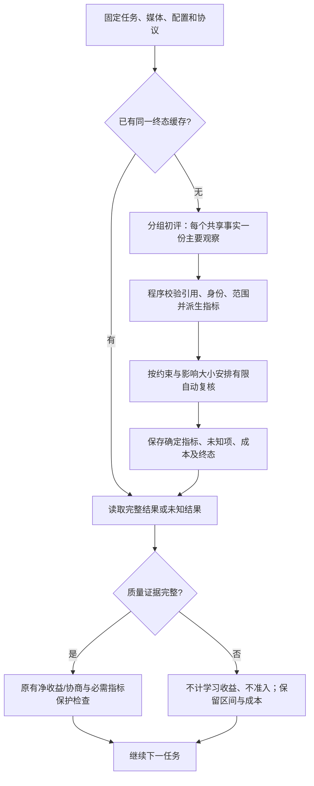

# V38：有限自动复核与自动暂缓

保留 Qwen3.8 Max、共享事实协议和净收益/协商选择器。此次修改的是自动复核调度、终态缓存与部分结果核算，不增加针对 chain_toy 或其他任务的关键词规则。人工标签不再是运行下一批任务的前置条件。

## 当前流程



`needs_review` 为兼容现有消费代码保留，但不代表必须人工解锁。
新字段 `verification_metadata.automation.disposition` 中，`abstained` 表示自动暂缓，`measured` 表示已测得（不保证约束通过），`integrity_error` 表示需要排查证据完整性问题。

## 有限复核

四份 `configs/h3_story350_*.json` 均设置：

```json
{
  "unresolved_policy": "continue",
  "auto_review": {
    "policy": "decision_relevant",
    "min_quality_impact": 0.02,
    "max_components_per_video": 3,
    "confirmations": 1,
    "max_calls_per_criterion": 2,
    "max_calls_per_video": 8,
    "max_calls_per_run": 200,
    "max_seconds_per_video": 600
  }
}
```

`auto_review` 实际位于 `verifier.runtime`、`verifier.final` 内。初评 `repeats=1` 保持不变。

- 所有初评完成后统一安排复核，优先处理仍可能影响必需条件的未知项，再按指标权重决定优先级。
- 有共享事实依赖的指标整体复核、整体提交，不能拆开凑数。
- 每个视频终态最多安排 3 个依赖组，每组一次增强观察（最多附带一次有预算的响应修正）；调用、耗时及运行总账本继续有效。该组数是每个终态的调度上限，跨阶段共享的实际调用限额仍由账本约束。
- 已经用完格式重评机会、且没有其他有效未知项的组，不再启动第二套复核循环。身份已阻塞的组也不会启动逐指标重试。
- 低影响或超过调度限额的项目保留未知；不通过降低阈值、填零或删指标制造成功。
- `review_schedule.json` 记录每组是否安排及原因。影响大小是冻结指标加权均值的最大可能变化代理，包含可能参与基础质量奖励的通用指标；不是学习奖励，也不是对具体策略选择无影响的数学证明。

对未知项仍需按原准入规则保守处理。减少复核可能降低完整可测覆盖率，因此覆盖率、未知原因、调用成本必须一起报告。

旧配置默认保留 `all_uncertain`，便于明确复现；单组诊断命令是显式请求复核该组，不使用批次调度过滤。

## 终态与部分结果

每次返回的评估写入 `terminal.json`。视频、任务、配置、协议相同且启用缓存时，完整或未知结果都直接复用，不重判直到成功。改变模型、采样、协议等会产生不同摘要。显式关闭缓存的独立最终评估路径保持原语义。

`result.json` 仍只表示完整评估，`needs_review.json` 保存不完整证据。API 故障、欠费、媒体损坏及内部异常不伪装成视觉未知，也不缓存为正常终态。

学习、验证、测试继续使用已有 `unresolved_policy=continue`：暂缓当前不完整比较，不写入虚假的正负收益；不完整候选不准入，其他任务继续。测试覆盖率保留所有预定比较，不能只用幸存样本宣称完整测试收益。

暂缓记录现在也保存完整评估内容、已测指标、约束状态、质量区间、生成调用数/秒数与耗时。原评分、预算账本及准入阈值不变。

报告中的质量区间按声明的 rubric 计算，通用辅助指标另列，未知按可能范围计算，不是零分或置信区间。`net_rubric_quality_bounds` 在有完整生成成本代理时减去成本惩罚；它是报告指标，不替代既有学习奖励或协商效用。

## 同步和一次批量复测

运行必需同步 `src/evovideo_skill/`、`scripts/`、`configs/`。测试与文档可同步 `tests/`、`docs/`。不需要同步权重、重新准备数据或生成视频。

先在服务器仓库根目录确认：

```bash
PYTHONPATH=src python - <<'PY'
import json
from evovideo_skill.conditioning_verifier import VERIFIER_PROTOCOL_VERSION
c = json.load(open('configs/h3_story350_debug.json'))
print('协议:', VERIFIER_PROTOCOL_VERSION)
print('未知处理:', c['unresolved_policy'])
print('复核:', c['verifier']['final']['auto_review'])
PY
```

预期协议为 `bounded-automatic-evaluation-v38`。对已有视频一次批量复测，新建目录避免混合旧协议：

```bash
set -o pipefail
review_dir="$(mktemp -d outputs/h3_qwen38_v38_batch_XXXXXX)"

PYTHONPATH=src python scripts/recheck_conditioning_outputs.py \
  --run-dir outputs/h3_story350_semantics_v2_RowaH0 \
  --config configs/h3_story350_debug.json \
  --task-file outputs/story350_smoke15_semantics_v2_prepared/story350_h3.json \
  --output-dir "$review_dir" \
  2>&1 | tee "$review_dir.log"

PYTHONPATH=src python scripts/diagnose_verifier_batch.py \
  --run-dir "$review_dir" > "$review_dir.diagnostics.json"

PYTHONPATH=src python scripts/report_evaluation.py --run-dir "$review_dir"
```

API Key 使用原来的环境配置，不输出密钥。复测会调用评估模型，但不调用 H3 生成。若因服务错误中断，在同一命令增加 `--resume` 并保持同一目录；不要为了消除未知不断新建目录重评。

看 `summary.json` 的批处理是否完成、`automation_counts`、指标覆盖率及成本。`abstained` 不需要再运行人工复核包。批次完成不能证明模型判断准确或方法有收益；原有缺失的 baseline 也不会由复测补齐。

## 验证范围

离线回归涵盖依赖组不拆分、调度上限、格式重评终止、终态缓存与配置隔离、部分评分和成本保留、训练不写伪收益、验证不错误准入、测试不丢失未知分母、传输与证据错误仍中止。

这些检查验证程序行为，不证明真实视觉准确率。人工校准仍可作为独立抽查进行，但不作为日常批处理的人工解锁步骤。
